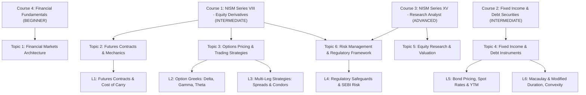

# FinanceX Phase 21 — Curriculum & Content Inventory

**Inventory Date**: 2026-09-08T08:55:00+05:30  
**Environment**: Live Remote Supabase (`https://timegqdfnokfzsupawuo.supabase.co`)  
**Purpose**: Baseline inventory of all educational entities across the database, mapping relationships, content depth, assessment coverage, and curriculum gaps.

---

## 1. Curriculum Tree Overview

---

## 2. Table-by-Table Inventory

### A. Certifications (`public.certifications`) — 4 Records
| UUID | Certification Name | Governing Body | Validity | Exam Linked | Status |
|---|---|---|---|---|:---:|
| `...0001` | NISM-Series-VIII: Equity Derivatives Certification | NISM | 3 yrs | Exam 1 | ACTIVE |
| `...0002` | NISM-Series-XV: Research Analyst Certification | NISM | 3 yrs | Exam 2 | ACTIVE |
| `...0003` | NCFM: Debt & Fixed Income Markets Module | NCFM | 5 yrs | Exam 3 | ACTIVE |
| `...0004` | FinanceX Certified Financial Strategist (FCFS) | FINANCEX ACADEMY | 10 yrs | Capstone | ACTIVE |

### B. Courses (`public.courses`) — 4 Records
| UUID | Title | Level | Hours | Certification | Lessons | Status |
|---|---|---|---|---|:---:|:---:|
| `...0001` | NISM Series VIII: Equity Derivatives Masterclass | `INTERMEDIATE` | 24.0 | NISM VIII | 4 | ACTIVE (Flagship) |
| `...0002` | Fixed Income & Debt Securities Analysis | `INTERMEDIATE` | 16.0 | NCFM Debt | 2 | ACTIVE (Core) |
| `...0003` | NISM Series XV: Research Analyst Certification | `ADVANCED` | 28.0 | NISM XV | 0 | CATALOG ANCHOR (Sparse) |
| `...0004` | Financial Fundamentals: Evolution of Money & Markets | `BEGINNER` | 10.0 | FCFS | 0 | CATALOG ANCHOR (Sparse) |

### C. Topics (`public.topics`) — 6 Records
| UUID | Topic Name | Difficulty | Associated Courses | Status |
|---|---|---|---|:---:|
| `...0001` | Financial Markets Architecture | `BEGINNER` | Course 4 | Populated |
| `...0002` | Futures Contracts & Mechanics | `INTERMEDIATE` | Course 1 | Populated |
| `...0003` | Options Pricing & Trading Strategies | `INTERMEDIATE` | Course 1 | Populated |
| `...0004` | Fixed Income & Debt Instruments | `INTERMEDIATE` | Course 2 | Populated |
| `...0005` | Equity Research & Valuation | `ADVANCED` | Course 3 | Populated |
| `...0006` | Risk Management & Regulatory Framework | `ADVANCED` | Course 1, Course 3 | Populated |

### D. Lessons (`public.lessons`) — 6 Records
| UUID | Title | Course | Topic | Order | Est. Mins | Content Rows |
|---|---|---|---|:---:|:---:|:---:|
| `...0001` | Fundamentals of Futures Contracts & Cost of Carry Model | Course 1 | Topic 2 | 1 | 35 | 1 |
| `...0002` | Option Greeks Deep Dive: Delta, Gamma & Theta Decay | Course 1 | Topic 3 | 2 | 45 | 1 |
| `...0003` | Multi-Leg Strategies: Bull Spreads, Straddles & Iron Condors | Course 1 | Topic 3 | 3 | 40 | 0 (Sparse) |
| `...0004` | Regulatory Safeguards, Margining & SEBI Risk Framework | Course 1 | Topic 6 | 4 | 30 | 0 (Sparse) |
| `...0005` | Bond Pricing Mechanics, Spot Rates & Yield to Maturity (YTM) | Course 2 | Topic 4 | 1 | 35 | 0 (Sparse) |
| `...0006` | Macaulay Duration, Modified Duration & Convexity Hedging | Course 2 | Topic 4 | 2 | 40 | 0 (Sparse) |

### E. Lesson Content & Resources
- **Lesson Content Rows**: 2
  - Lesson 1: Full cost of carry derivation, cash-and-carry arbitrage example, and formula blocks.
  - Lesson 2: Delta, Gamma, Theta partial derivatives, Black-Scholes sensitivities, and volatility smile.
- **Lesson Resources**: 4
  - PDF Cheat Sheets for Futures & Greeks (2 resources).
  - Bond yield curve models & SEBI circulars (2 resources).

### F. Assessment Bank (`public.questions`) — 8 Records
| UUID | Question Summary | Difficulty | Topic | Correct | Coverage |
|---|---|---|---|:---:|---|
| `...0001` | Delta Hedge Ratio Calculation (Call Delta 0.60) | `EASY` | Options | B | Quiz 1, Exam 1 |
| `...0002` | Gamma Peak at ATM Strike vs Expiry | `MEDIUM` | Options | C | Quiz 1, Exam 1 |
| `...0003` | Bull Call Spread Maximum Profit Calculation | `EASY` | Options | B | Quiz 1, Exam 1 |
| `...0004` | Vega sensitivity as time to expiry decreases | `MEDIUM` | Options | B | Quiz 1, Exam 1 |
| `...0005` | Negative Theta decay profile of option buyers vs sellers | `EASY` | Options | B | Quiz 1, Exam 1 |
| `...0006` | Inverse price-yield bond mechanics with 100 bps shift | `EASY` | Fixed Income | B | Exam 1 |
| `...0007` | SEBI cooling-off period under Research Analyst regulations | `HARD` | Risk/Regs | A | Exam 1 |
| `...0008` | Cost of carry continuous compounding futures theoretical price | `HARD` | Futures | B | Exam 1 |

### G. Quizzes & Mock Exams
- **Quizzes**: 3
  - Quiz 1: *Option Greeks & Volatility Mastery Quiz* (5 mapped questions)
  - Quiz 2: *Futures Pricing & Cash-and-Carry Quiz* (0 mapped questions)
  - Quiz 3: *Bond Duration & Yield Curve Checkpoint* (0 mapped questions)
- **Mock Exams**: 3
  - Exam 1: *NISM Series VIII: Equity Derivatives Full Mock Examination* (8 mapped questions)
  - Exam 2: *NISM Series XV: Research Analyst Full Mock Examination* (0 mapped questions)
  - Exam 3: *NCFM Financial Markets & Fixed Income Diagnostic* (0 mapped questions)

---

## 3. Identified Gaps & Weak Areas

1. **Course Breadth**:
   - Course 3 (*NISM XV Research Analyst*) and Course 4 (*Financial Fundamentals*) have 0 lessons.
2. **Lesson Content Depth**:
   - Lessons 3, 4, 5, and 6 in Courses 1 and 2 lack dedicated markdown content blocks.
3. **Assessment Volume**:
   - 8 questions total in the bank is insufficient for diverse multi-exam generation.
   - Quizzes 2 & 3 and Mock Exams 2 & 3 lack question mappings.
4. **Referential Integrity**:
   - All existing IDs are clean, foreign keys are fully valid, and zero orphan records exist.

---
*Inventory certified for Phase 21 expansion planning.*
