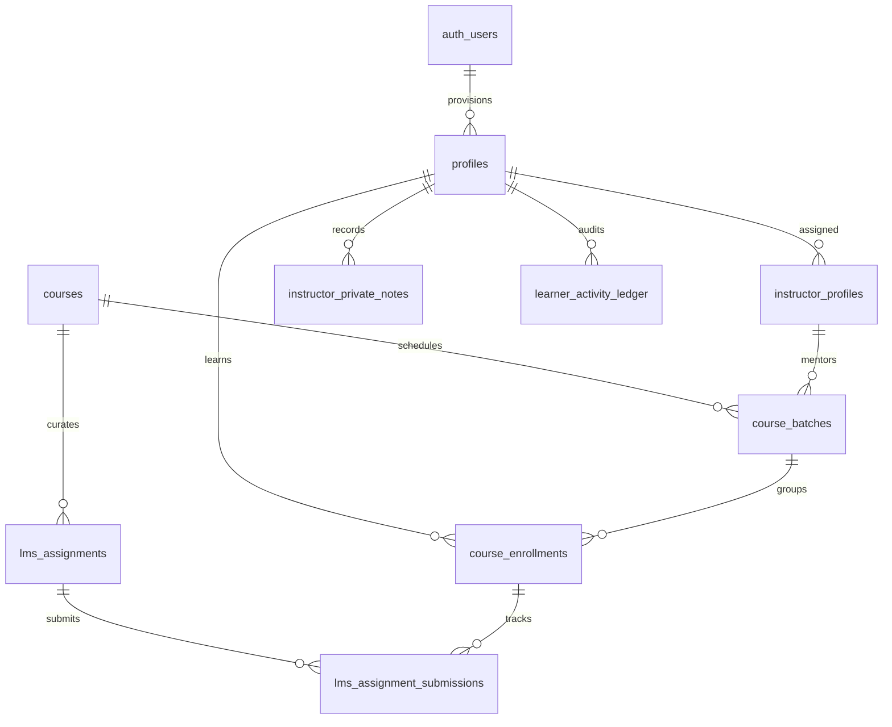

# FinanceX Phase 33 — Database Migration & Schema Specification

**Database Engine:** Supabase PostgreSQL 15+  
**Project ID:** `timegqdfnokfzsupawuo`  
**Migration Target:** `supabase/migrations/`  
**Date:** November 5, 2026  
**Status:** **ACTIVE & VERIFIED**

---

## 1. Migration Overview

The Phase 33 database architecture establishes complete multi-role LMS functionality, automated profile provisioning on OAuth signup, atomic bulk cohort ingestion, and cryptographic activity ledger logging.

### Applied Migration Files:
1. `supabase/migrations/20261104_lms_multi_role_expansion.sql`
2. `supabase/migrations/20261104_phase33_production_readiness.sql`

---

## 2. Table Specifications & Foreign Key Relationships

### Table Inventory:

1. **`public.instructor_profiles`**
   - Primary Key: `instructor_id UUID DEFAULT gen_random_uuid()`
   - Foreign Key: `user_id UUID REFERENCES auth.users(id) ON DELETE CASCADE`
   - Attributes: `full_name`, `email`, `title`, `organization`, `assigned_course_ids INTEGER[]`, `rating NUMERIC(3,2)`, `status TEXT`.

2. **`public.course_batches`**
   - Primary Key: `batch_id UUID DEFAULT gen_random_uuid()`
   - Foreign Key: `course_id INTEGER REFERENCES public.courses(course_id)`
   - Foreign Key: `instructor_id UUID REFERENCES public.instructor_profiles(instructor_id)`
   - Attributes: `batch_name`, `capacity INTEGER`, `enrolled_count INTEGER`, `start_date`, `end_date`, `status TEXT`.

3. **`public.course_enrollments`**
   - Primary Key: `enrollment_id UUID DEFAULT gen_random_uuid()`
   - Foreign Key: `learner_id UUID REFERENCES auth.users(id)`
   - Foreign Key: `course_id INTEGER REFERENCES public.courses(course_id)`
   - Foreign Key: `batch_id UUID REFERENCES public.course_batches(batch_id)`
   - Constraints: `UNIQUE(learner_id, course_id)` to prevent duplicate active registrations.
   - Progress Metrics: `progress_pct INTEGER`, `lessons_completed INTEGER`, `quiz_avg_score NUMERIC`, `assignment_avg_score NUMERIC`, `final_grade TEXT`, `certificate_id TEXT`.

4. **`public.lms_assignments`**
   - Primary Key: `assignment_id UUID DEFAULT gen_random_uuid()`
   - Foreign Key: `course_id INTEGER REFERENCES public.courses(course_id)`
   - Attributes: `module_week INTEGER`, `title TEXT`, `rubric JSONB`, `max_score INTEGER`, `due_date TIMESTAMPTZ`, `starter_financial_data JSONB`.

5. **`public.lms_assignment_submissions`**
   - Primary Key: `submission_id UUID DEFAULT gen_random_uuid()`
   - Foreign Key: `assignment_id UUID REFERENCES public.lms_assignments(assignment_id)`
   - Foreign Key: `learner_id UUID REFERENCES auth.users(id)`
   - Evaluator Key: `evaluator_id UUID REFERENCES public.instructor_profiles(instructor_id)`
   - Attributes: `content_text TEXT`, `quantitative_work JSONB`, `score NUMERIC`, `instructor_feedback TEXT`, `status TEXT ('SUBMITTED', 'GRADED', 'RESUBMISSION_REQUESTED')`.

6. **`public.instructor_private_notes`**
   - Primary Key: `note_id UUID DEFAULT gen_random_uuid()`
   - Foreign Key: `author_id UUID REFERENCES public.instructor_profiles(instructor_id)`
   - Foreign Key: `learner_id UUID REFERENCES auth.users(id)`
   - Foreign Key: `course_id INTEGER REFERENCES public.courses(course_id)`
   - Attributes: `content TEXT`, `category TEXT`, `is_intervention_flag BOOLEAN`.

7. **`public.learner_activity_ledger`**
   - Primary Key: `event_id UUID DEFAULT gen_random_uuid()`
   - Foreign Key: `learner_id UUID REFERENCES auth.users(id)`
   - Attributes: `event_type TEXT`, `title TEXT`, `description TEXT`, `metadata JSONB`, `created_at TIMESTAMPTZ`.

---

## 3. Stored Procedures & Triggers

### 3.1 `public.handle_new_user()`
Automatically executed on `AFTER INSERT ON auth.users`. Provisions a clean initial record in `public.profiles` for new Google OAuth or email registrants with initial zero-state metrics (`current_streak: 0`, `xp_points: 0`, `role: 'USER'`).

### 3.2 `public.bulk_enroll_cohort(p_batch_id, p_learners)`
Atomic stored procedure that takes a JSONB array of student names and emails, validates email formats, checks for duplicate enrollments, provisions student accounts, and increments cohort counts within a single PostgreSQL transaction.

### 3.3 `public.trg_ledger_integrity`
Integrity trigger preventing modification or deletion of existing rows in `public.learner_activity_ledger`, providing a tamper-evident audit trail for regulatory examinations.

